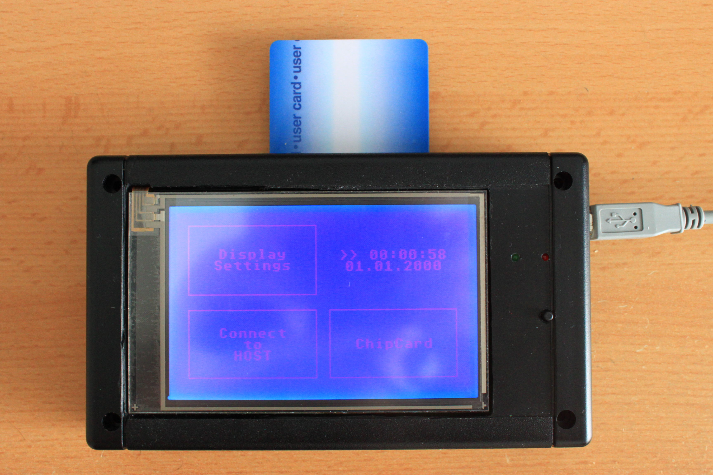

In my USB-Board i use 240x128 dots Display with Touch.

  

This USB-Board can be connected to Front- or Back-USB for making a configuration of NAS or (W)LAN-Router or Server.
Now passwords from chipcard can be transmitted to server for mounting hard disks or files with filesystems,
which can be encrypted by loopAES.The passwords are stored in memory-chipcard (max 15 passwords). Supported cards with 
max 64 kBytes memory.  
In TOOLs are alsamixer(amixer command) for manage Soundcards and MP3 player (mpg123 command).
There is a configuration and showing info of networkcards. Network services can be managed like ssh, samba, ftpd.
The tty terminals can be switched by USB-Board. USB sorages can be mounted or umounted, backUped.

If you have interests on my project please contact me.
Show video at youtube: https://www.youtube.com/@alreim
You can buy the device here: https://www.ebay.de/itm/335985004843

